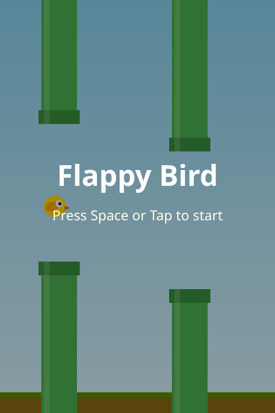
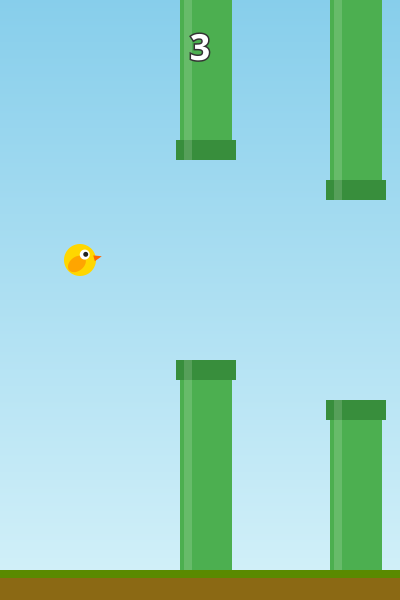
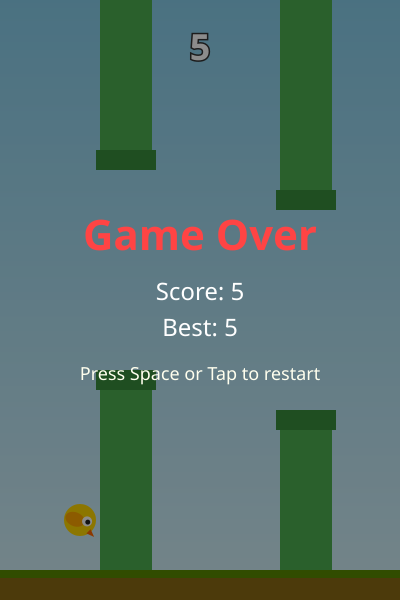

# 🐦 Flappy Bird Mini Game

A lightweight Flappy Bird clone built with **React 18**, **TypeScript**, and **Vite**. All game rendering is done on an HTML5 `<canvas>` — no external game library needed.

---

## Screenshots

### Start Screen


### Gameplay


### Game Over


---

## Getting Started

### Prerequisites
- Node.js ≥ 18

### Install & Run

```bash
npm install
npm run dev
```

Open [http://localhost:5173](http://localhost:5173) in your browser.

### Build for Production

```bash
npm run build
npm run preview
```

---

## How to Play

| Action | Control |
|---|---|
| Flap / Start | `Space`, `↑ Arrow`, or **Click / Tap** |
| Restart | Same as above after Game Over |

Fly the bird through the gaps between the pipes without hitting them or the ground.

---

## Project Structure

```
mini-game/
├── index.html
├── package.json
├── tsconfig.json
├── vite.config.ts
└── src/
    ├── main.tsx          # React entry point
    ├── App.tsx           # Canvas setup & keyboard/tap input
    ├── App.module.css    # Wrapper styles
    ├── useFlappyBird.ts  # All game logic (physics, pipes, collision, draw)
    └── index.css         # Global reset
```

---

## Game Constants (easy to tweak)

All difficulty knobs live at the top of [`src/useFlappyBird.ts`](src/useFlappyBird.ts):

| Constant | Value | Effect |
|---|---|---|
| `GRAVITY` | `0.35` | How fast the bird falls |
| `JUMP_VEL` | `-8` | Upward velocity on each flap |
| `PIPE_GAP` | `200` | Height of the gap between pipes |
| `PIPE_SPEED` | `2.0` | Horizontal pipe movement speed |
| `PIPE_INTERVAL` | `2200ms` | Time between pipe spawns |

---

## Tech Stack

- [React 18](https://react.dev/)
- [TypeScript 5](https://www.typescriptlang.org/)
- [Vite 5](https://vitejs.dev/)
- HTML5 Canvas API
